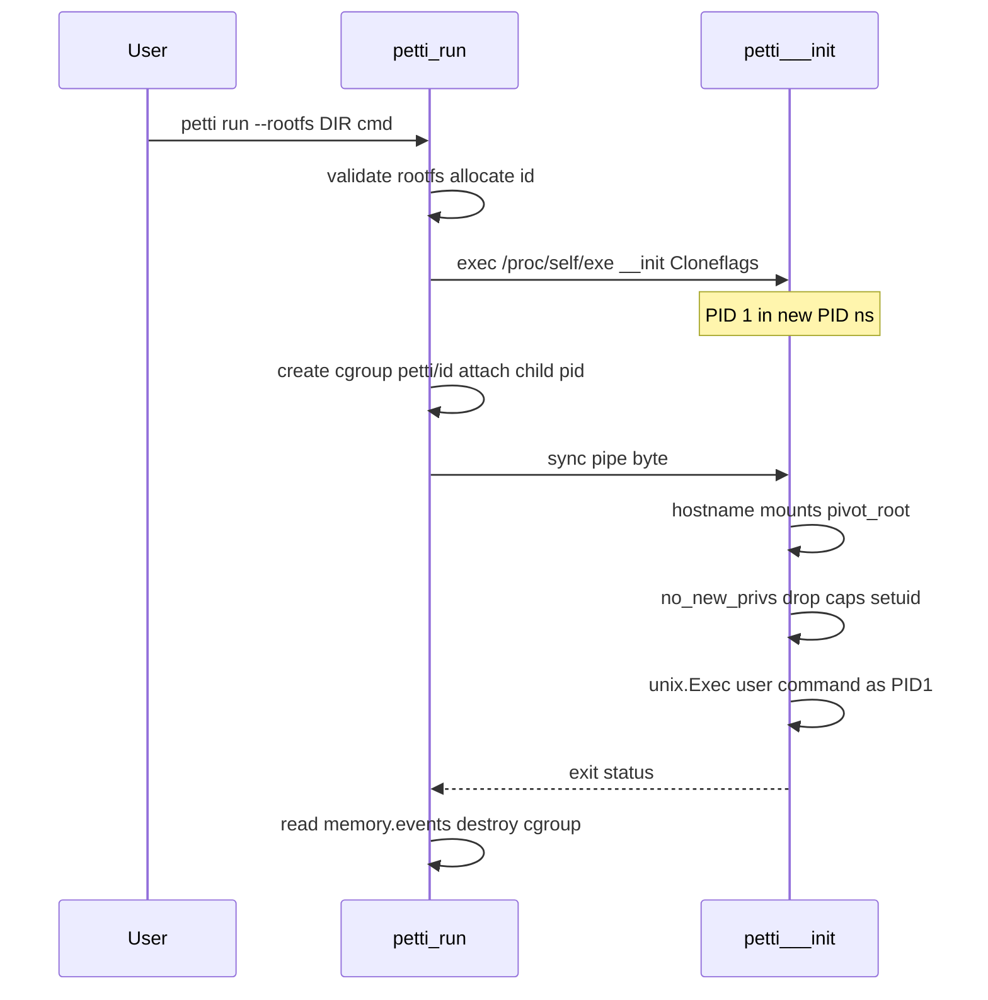

# Architecture

Petti is a Linux container runtime. This document grows with each milestone.

## High-level packages

| Package | Role |
|---------|------|
| `cmd/petti` | Binary entrypoint |
| `internal/cli` | Flags, help, version, exit codes |
| `internal/version` | Build-time version injection |
| `internal/container` | Lifecycle helpers (ID, run orchestration) |
| `internal/runtime` | Re-exec init, namespaces, mounts |
| `internal/cgroups` | cgroup v2 manager |
| `internal/rootfs` | overlayfs mount, OCI→overlay whiteouts, bind mounts |
| `internal/image` | Local image store, layer unpack/merge, pull orchestration |
| `internal/registry` | OCI Distribution client (auth, manifests, blobs) |
| `internal/state` | Data root, atomic writes, file locks |
| `internal/network` | Bridge `petti0`, veth, IPAM, NAT, `-p` |
| `internal/seccomp` | Default denylist via `seccomp(2)` + classic BPF |
| `internal/build` | Petfile parser + layer-cached `petti build` |
| `internal/archive` | `petti save` / `petti load` image tarballs |
| `internal/compose` | `petti.yaml` multi-container runner |
| `internal/system` | `petti system prune` |

## Milestone 1–2 references

- `namespaces(7)`, `pid_namespaces(7)`, `mount_namespaces(7)`, `uts_namespaces(7)`, `ipc_namespaces(7)`
- `clone(2)` / `CLONE_NEW*` via `SysProcAttr.Cloneflags`
- `mount(2)`, shared-subtree propagation (`MS_PRIVATE`)
- `pivot_root(2)` (Milestone 2; replaces `chroot`)
- `sethostname(2)`, `mknod(2)`, `execve(2)` / `unix.Exec`
- `capabilities(7)`, `capset(2)`, `prctl(2)` (`PR_SET_NO_NEW_PRIVS`, `PR_CAPBSET_DROP`)
- `setuid(2)` / `setgid(2)` / `setgroups(2)`
- `cgroups(7)` / cgroup v2 (`memory.max`, `cpu.max`, `pids.max`, `memory.events`)
- `proc(5)`, `sysfs(5)`, `devpts`

## Re-exec pattern

Go’s runtime is multithreaded, so `unshare(2)` in the same process is unsafe.
Petti uses the standard re-exec approach:

1. Parent (`petti run`) validates `--rootfs`, allocates a container ID / hostname.
2. Parent creates a sync pipe and starts a child with
   `exec.Command("/proc/self/exe", "__init", ...)` and
   `SysProcAttr.Cloneflags = CLONE_NEWNS|CLONE_NEWUTS|CLONE_NEWPID|CLONE_NEWIPC`.
3. The child is PID 1 in the new PID namespace. It waits for one byte on the
   inherited sync FD (so the parent can finish uid/gid mapping, cgroup attach,
   and network setup in later milestones).
4. Child: `Sethostname` → private mounts → `/proc` `/dev` `/sys` under rootfs →
   `pivot_root` + unmount old root → `no_new_privs` → drop capabilities →
   optional `setuid`/`setgid` → `chdir(workdir)` → `unix.Exec` (still PID 1).
5. `runtime.LockOSThread()` is held in `__init` while touching per-thread kernel state.



## cgroups v2 (Milestone 3)

Petti requires the unified hierarchy (`/sys/fs/cgroup/cgroup.controllers`). Legacy
v1 is rejected with a clear error.

Per container: `/sys/fs/cgroup/petti/<id>` with optional `memory.max` (and
`memory.swap.max=0`), `cpu.max`, `pids.max`. The parent writes the child's host
PID into `cgroup.procs` **before** releasing the sync pipe. Memory/CPU apply
immediately; `pids.max` is written by `__init` just before `pivot_root` so the
multithreaded Go re-exec is not killed under a tight limit. After exit,
`memory.events` `oom_kill` is checked (exit 137) and the cgroup directory is
removed.

## pivot_root (Milestone 2)

`chroot` only changes the process root; the old root mount remains and can be
reached again with classic escape techniques. `pivot_root` swaps the mount
namespace root and lets Petti `umount` the old root (`MNT_DETACH`), so the host
filesystem tree is gone from the namespace.

### Why a sync pipe?

Clone returns before the parent has finished work that the child depends on
(writing `/proc/<pid>/uid_map`, moving the task into a cgroup, plugging a
veth). The child blocks on the pipe until the parent signals “go”.

## Mount setup (Milestone 1)

1. `mount MS_REC|MS_PRIVATE` on `/` so nothing propagates to the host.
2. Bind-mount the rootfs onto itself (mount point for a future `pivot_root`).
3. `proc` on `$rootfs/proc`.
4. `tmpfs` on `$rootfs/dev`, then `mknod` for `null` `zero` `full` `random` `urandom` `tty`
   (bind-mount fallback from the host if `mknod` fails).
5. `devpts` on `$rootfs/dev/pts`, `tmpfs` on `$rootfs/dev/shm`.
6. Read-only `sysfs` on `$rootfs/sys`.

## On-disk layout (Milestone 4)

- Root: `/var/lib/petti` (or `PETTI_ROOT`)
- Rootless: `~/.local/share/petti`

```text
blobs/sha256/<hex>     content-addressed blobs (config + compressed layers)
layers/sha256/<diffID>/ unpacked layer trees (OCI .wh.* preserved)
images/<repo>_<tag>.json  image records (id, layers, config)
containers/<id>/rootfs/   merge destination for `run` (pre-overlay)
```

Pull flow: parse ref → auth token → manifest/index → platform select →
download+verify blobs → gunzip+diffID verify → unpack layer → save record.

## Overlayfs (Milestone 5)

Per container under `containers/<id>/rootfs/{merged,upper,work}`:

- **lowerdir**: shared unpacked image layers (bottom→top)
- **upperdir/workdir**: writable per-container layer
- OCI `.wh.*` markers are converted to overlay whiteouts (char 0:0) and
  `trusted.overlay.opaque` before mount
- Mount option length: lower paths passed as `/proc/self/fd/N` so the option
  string stays short

Volumes are bind-mounted onto `$rootfs/$dest` **before** `pivot_root`.

## State machine (Milestone 5)

`created → running → exited|stopped` (plus `removing` during `rm`).

Persisted in `containers/<id>/state.json`. Detached containers keep their
cgroup and overlay until `stop`/`rm`. `ps` refreshes `running→exited` when the
host PID is gone. `exec` re-execs as `__exec` and `setns(2)` into the target.

## Networking (Milestone 6)

Default `--network bridge`:

1. Ensure Linux bridge `petti0` (`10.88.0.1/16`) and `net.ipv4.ip_forward=1`.
2. Idempotent `iptables` `MASQUERADE` for `10.88.0.0/16` and FORWARD accepts.
3. Allocate a container IP from a disk-backed pool (`network/ipam.json`).
4. Create a veth pair; move the peer into the container netns (`CLONE_NEWNET`);
   rename to `eth0`, assign IP, bring up `lo`/`eth0`, default route via the bridge.
5. Optional `-p host:container[/proto]` → DNAT in `PREROUTING` + `OUTPUT`.
6. Bind-mount per-container `/etc/hosts` and `/etc/resolv.conf` (host resolv copy).

`--network none` still creates a netns (loopback only). `--network host` omits
`CLONE_NEWNET`. Container-to-container traffic uses the bridge L2 domain.

Parent still finishes cgroup **and** network setup before the sync-pipe byte so
the user process never races an unconfigured stack.

## Rootless mode (Milestone 7)

When `geteuid() != 0` (or `--rootless`):

1. Add `CLONE_NEWUSER`. Map the host uid/gid to container root (`0`). If
   `/etc/subuid`+`/etc/subgid` and `newuidmap`/`newgidmap` (`uidmap` package)
   exist, also map the subordinate range to container ids `1…N`.
2. Default `--network host` (bridge needs host `CAP_NET_ADMIN`). `none` works;
   `bridge` / `-p` are rejected.
3. Try overlayfs with `userxattr`; on failure, copy-merge layers into the
   container bundle and warn.
4. Try a cgroup under the current systemd-user delegation
   (`/proc/self/cgroup`); if limits cannot be applied, warn and continue.

Data root stays `~/.local/share/petti` (or `PETTI_ROOT`). Ubuntu 23.10+ may set
`kernel.apparmor_restrict_unprivileged_userns=1`, which blocks unprivileged
userns exec — see `docs/apparmor/petti` and DESIGN-DECISIONS.

## Hardening (Milestone 8)

After `pivot_root` (and optional `--read-only` remount):

1. `PR_SET_NO_NEW_PRIVS`
2. Capability bounding/effective/permitted set (`--cap-add` / `--cap-drop`)
3. Seccomp denylist (`--security-opt seccomp=unconfined` to skip)
4. Optional `setuid`/`setgid` then `exec`

Sensitive paths are masked during mount setup (before pivot): `/proc/kcore`,
`/proc/sysrq-trigger`, `/proc/timer_list`, `/sys/firmware` (tmpfs or
`/dev/null` bind); `/proc/sys`, `/proc/irq`, `/proc/bus` remounted read-only.

Seccomp is a hand-rolled classic BPF filter (`seccomp(2)` /
`SECCOMP_SET_MODE_FILTER`) — no libseccomp dependency.

## Build / compose (Milestone 9)

`petti build` reads a Petfile (`FROM`, `RUN`, `COPY`, `ENV`, `WORKDIR`, `CMD`,
`ENTRYPOINT`). Each `COPY`/`RUN` produces a content-addressed layer with a
disk-backed build cache under `buildcache/`. Config-only instructions update
the image config without a new layer. Built tags are stored as
`localhost/<name>:<tag>`.

`petti save`/`load` use a gzipped tar (`manifest.json` + `blobs/sha256/…`).

`petti compose up|down` reads a minimal `petti.yaml` `services:` map and starts
detached containers named `<project>_<service>`.
